# Loski 🎧

A private Discord music bot that streams **real Spotify audio** (your Premium account, 320 kbps) into a voice channel. You control it, along with any co-DJs you pick; everyone in the call can listen, like songs and vote to skip. Built in Rust on [librespot](https://github.com/librespot-org/librespot), [songbird](https://github.com/serenity-rs/songbird) and [twilight](https://github.com/twilight-rs/twilight), with every message drawn as a Discord card using Loski's own icon set.

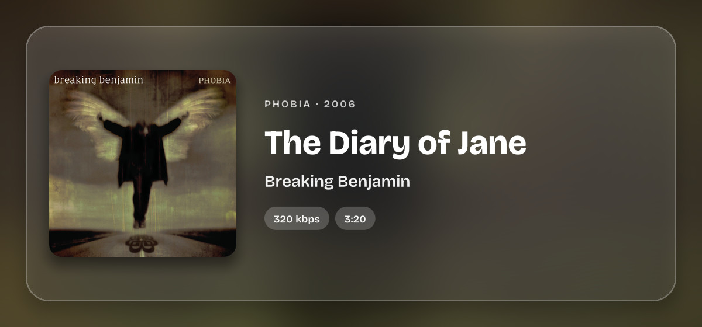

> **Heads-up:** streaming Spotify through librespot isn't allowed by Spotify's terms of service. Loski is meant for private use with your own account. Spotify could, in theory, act on an account that does this.
>
> Loski is an independent project. It isn't affiliated with, endorsed by or sponsored by Spotify or Discord. Spotify and Discord are trademarks of their respective owners.

**[A tour](#a-tour)** · **[Setup](#setup)** · **[Day to day](#day-to-day)** · **[Commands](#commands)** · **[Settings](#settings)** · **[Friends](#friends)** · **[Good to know](#good-to-know)** · **[Development](#development)**

## A tour

<sub>The pictures are Loski's real cards, drawn from its own code for a sample evening of listening. Album covers belong to their owners; the lyrics card shows placeholder text.</sub>

### The now-playing panel

<p align="center">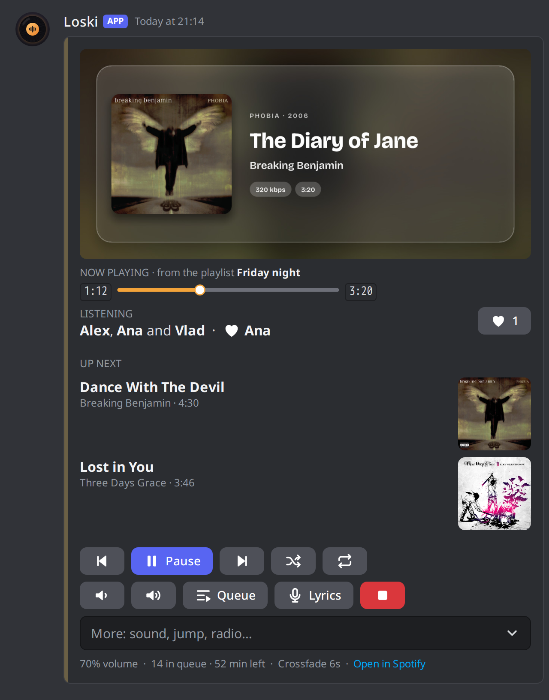</p>

- **Artwork for every song:** a frosted-glass banner drawn from the cover, with the album, year and audio quality. The card takes its colour from the cover too.
- **Where it's playing from**, a progress bar made of Loski's own icons, and **who's in the call**, with a ♥ anyone there can press.
- **Up next** with covers, the way the Spotify app shows it (or the Spotify app's own queue, when it's in charge).
- **Controls:** previous, pause, skip, shuffle, repeat, volume, the queue, lyrics and stop. The **More** menu jumps 15 seconds or to a time you type, restarts the song, starts a radio, and switches the sound filter.
- **The song in the voice channel's status**, so people see what's on before they join.
- When Loski leaves, the panel turns into a **recap** of the session (see [Your listening](#your-listening)).

### Sing along

<p align="center">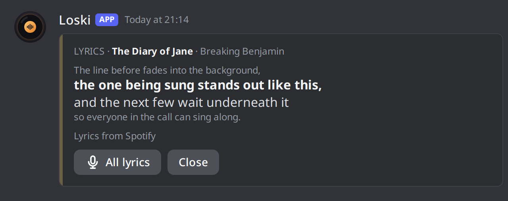</p>

The **Lyrics** button posts a card that follows the song line by line: the line being sung stands out, with the one before and the next few around it. It moves on to the next song by itself. `/lyrics` shows the words of any song, a page at a time. Lyrics come from Spotify, timed to the song, or from [LRCLIB](https://lrclib.net) when Spotify has none.

### The queue and requests

<p>
  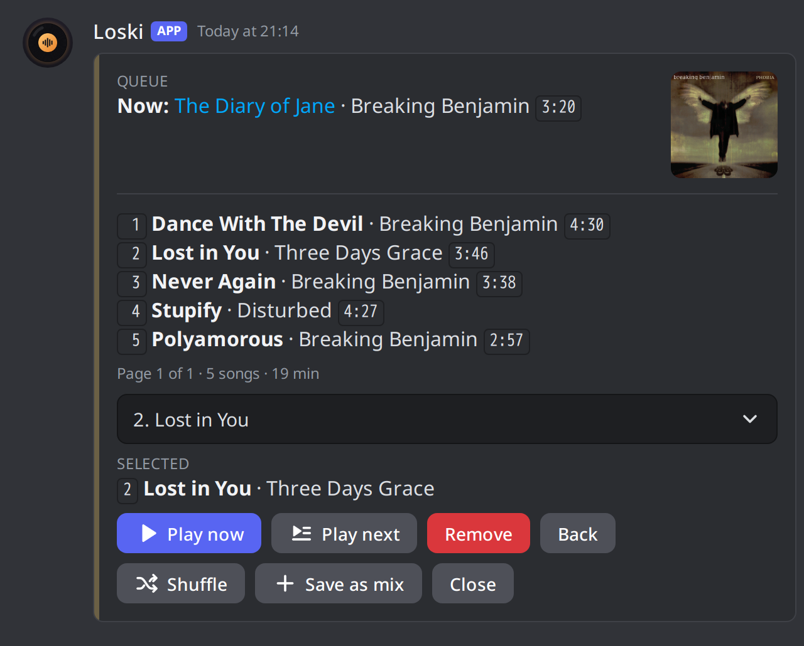
  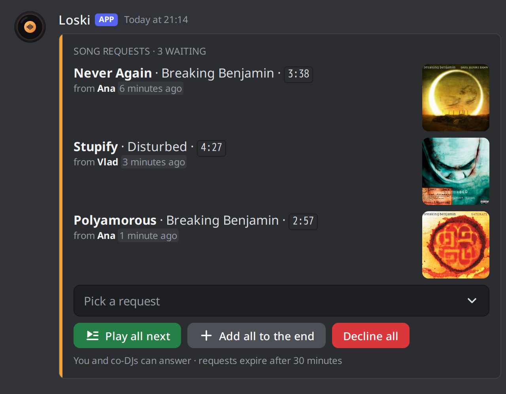
</p>

- **The queue card:** pick any song to play it now, play it next or remove it; shuffle, drop repeats, or save the whole queue as a mix. `/clear`, `/remove`, `/dedupe` and `/shuffle` come with an **Undo** button.
- **Smart shuffle:** songs by the same artist don't play back to back.
- **Requests:** anyone in the server can `/request` a song. They gather on one card where you or a co-DJ play them next, add them, or decline them, one by one or all at once.
- **Search** with tabs for songs, albums, playlists and artists, live suggestions as you type, Spotify links of every kind, and right-click → **Play with Loski** on any message with a link.

### Your listening

<p>
  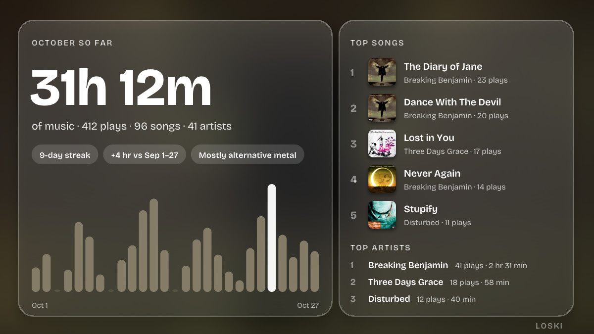
  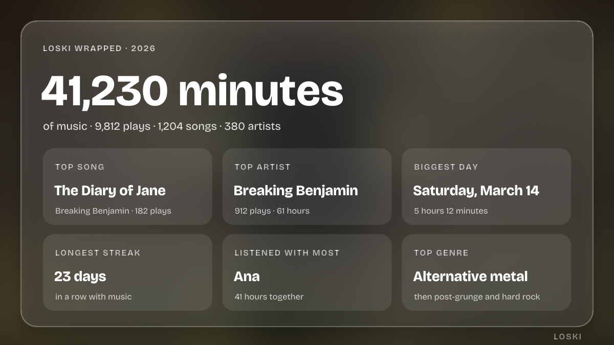
</p>

<p align="center">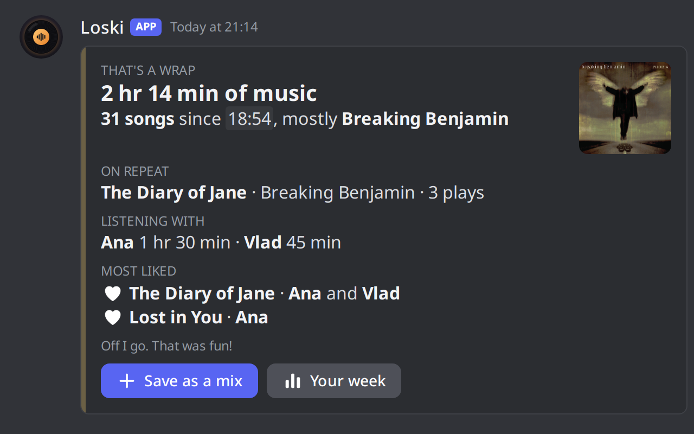</p>

- **`/stats`** draws your listening as a picture: time, top songs, artists and genres, streaks and a daily chart, with tabs for the week, the month, all time and **Together** (time and songs with each friend).
- **Loski Wrapped** (`/wrapped`): your year in two pictures, and in your DMs on January 1st. A recap of each month arrives on the 1st.
- **The goodbye recap:** when Loski leaves, the panel sums up the session: how long, the song on repeat, who you listened with and what they liked. Save it as a mix with one button.
- **`/history`** finds what you played, by words, by time, by a friend who was in the call, or by friends' requests, and plays it again.
- **Blend:** every Monday, a mix of your top songs woven with what friends liked or asked for.
- **Milestones:** a small DM for 100 hours with Loski, your 1,000th song, or 30 days in a row.

### Settings and friends, in Discord

<p>
  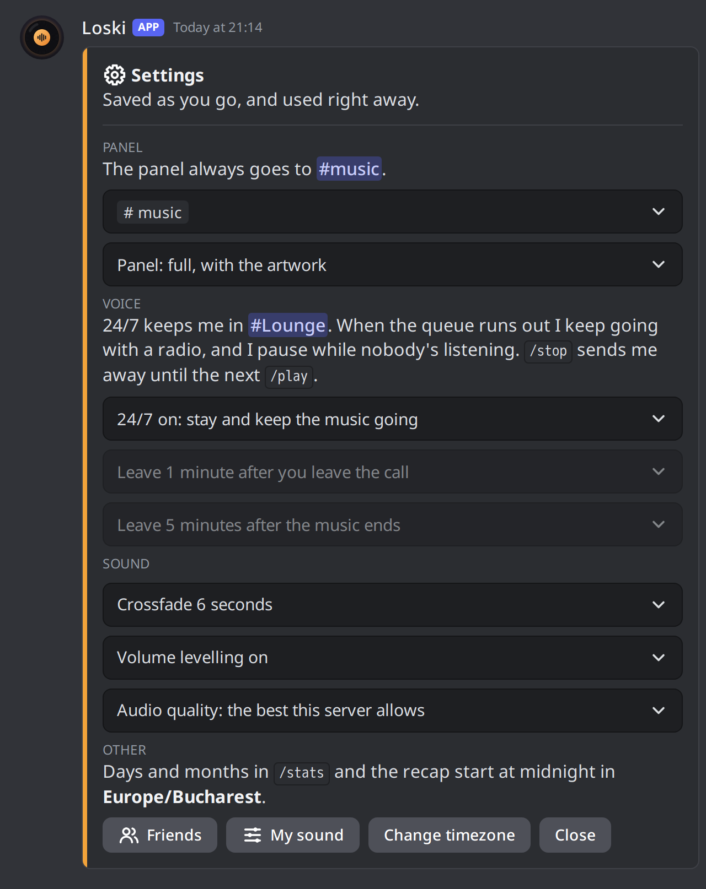
  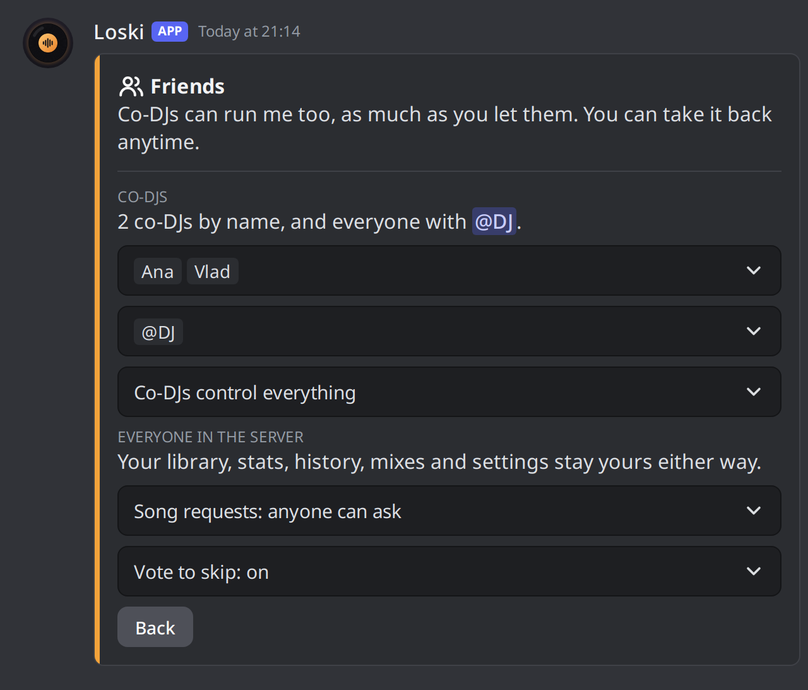
</p>

<p>
  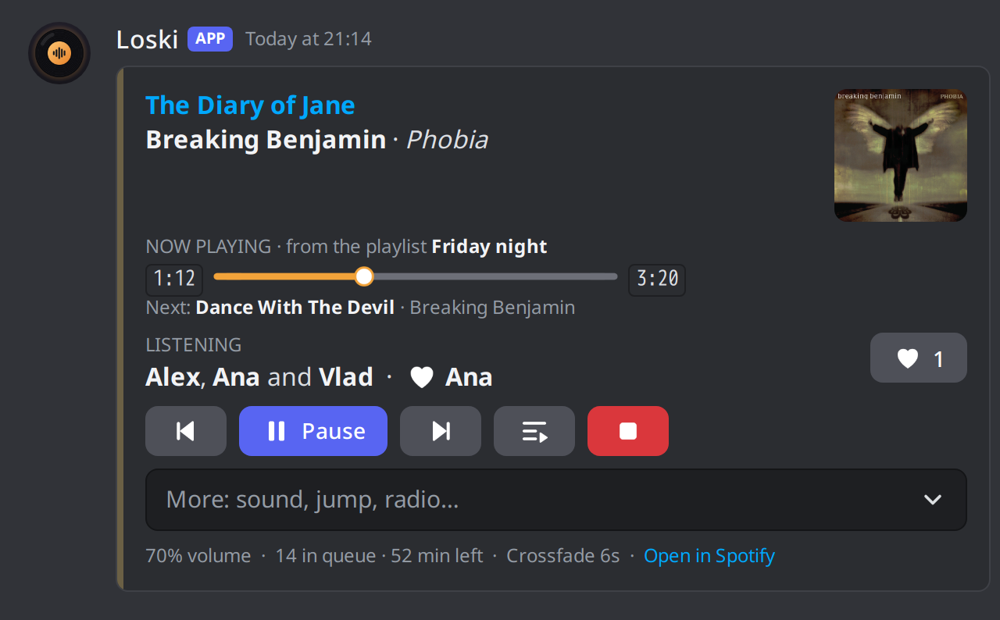
  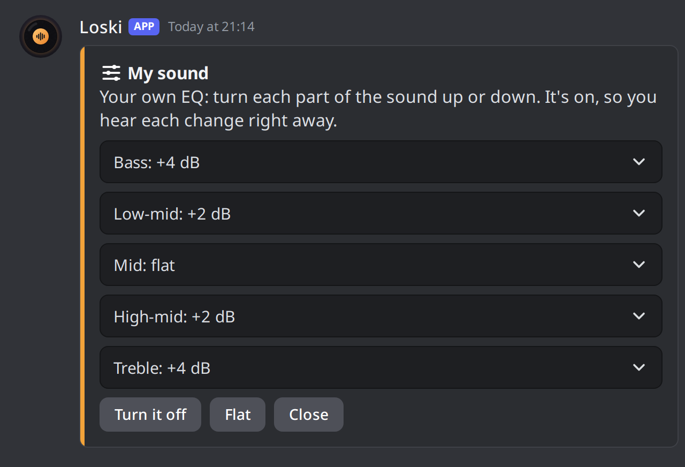
</p>

- **`/settings`** changes everything that isn't a password, in a card only you can see, and saves it right away: the panel's channel, the **compact panel** (left), when Loski leaves, crossfade, volume levelling, audio quality and your timezone.
- **24/7 mode:** Loski stays in its channel, comes back after a restart, keeps going with a radio when the queue runs out, and pauses while nobody's listening.
- **My sound** (right): your own five-band EQ, next to the presets (bass, treble and vocal boost, nightcore, slowed + reverb, 8D).
- **Friends:** pick co-DJs by name or with a DJ role, and let them control everything or only add songs. Turn requests and votes to skip on or off.

### Sound and Spotify

- **Real Spotify playback** at 320 kbps, sent to Discord at the best bitrate your server allows.
- **Gapless**, with optional crossfade that keeps albums gapless; silence at the start and end of songs is skipped, and a limiter keeps boosted sound from clipping. Soft pause, smooth volume, and a sleep timer that fades out.
- **Spotify Connect:** pick **Loski** in the Spotify app's device list and your phone becomes the remote. **Follow mode** mirrors whatever you're playing on your own Spotify, in sync.
- **Your library:** `/liked`, `/playlist` (your playlists suggested as you type) and `/radio`.
- **Looks after itself:** rejoins voice after a dropout, reconnects to Spotify, DMs you when something needs you, tells you when a new version is out, and cleans its confirmations up after a few seconds.

## Setup

You need Docker (Docker Desktop on Windows and macOS) and Spotify Premium.

### 1. Start it

On Windows, double-click `loski.cmd`, or run it from a terminal in the repo folder:

```powershell
.\loski start
```

On Linux or macOS (see [Linux, macOS and Raspberry Pi](#linux-macos-and-raspberry-pi)):

```bash
./loski.sh start
```

It starts Docker if it isn't running, downloads the ready-made Loski image the first time (see [Prebuilt image](#prebuilt-image)), and waits until Loski says it's ready.

### 2. The setup page

<p>
  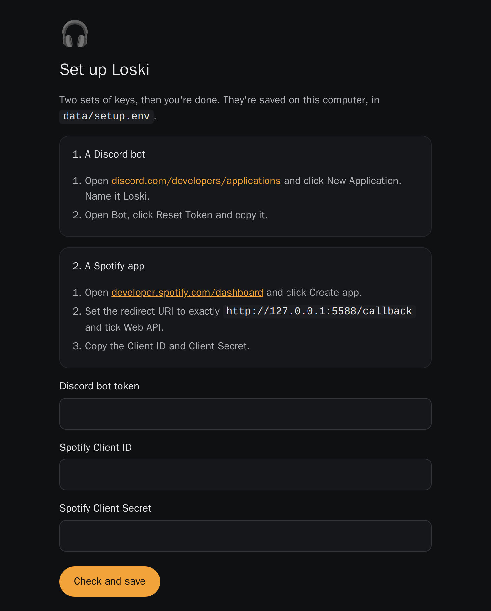
  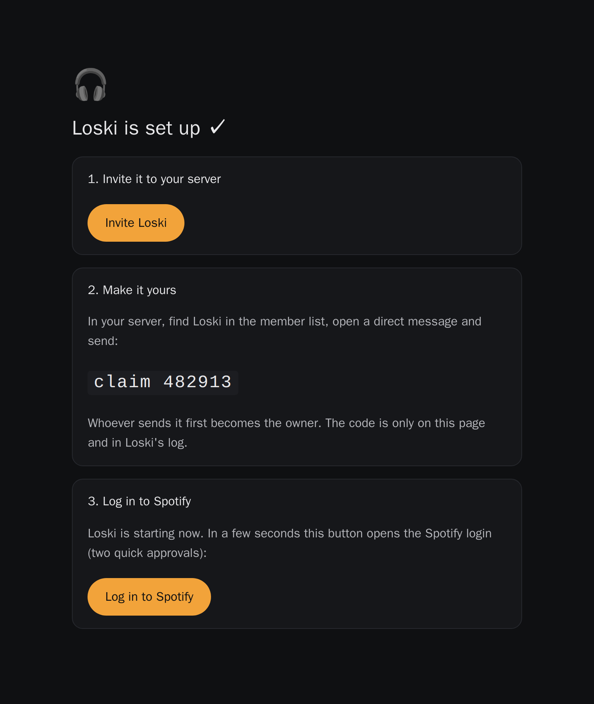
</p>

The first time, your browser opens **http://127.0.0.1:5588**, which asks for three keys and shows where to get each one:

1. **A Discord bot.** At [discord.com/developers/applications](https://discord.com/developers/applications), click **New Application**, name it **Loski**, open **Bot**, click **Reset Token** and copy the token.
2. **A Spotify app.** At [developer.spotify.com/dashboard](https://developer.spotify.com/dashboard), click **Create app**, set the redirect URI to exactly `http://127.0.0.1:5588/callback`, tick **Web API**, and copy the **Client ID** and **Client Secret**.

The page checks them with Discord and Spotify and saves them in `data/setup.env`. (You can put them in `.env` yourself instead; `.env` always wins. See `.env.example`.)

### 3. Invite, claim and log in

Once the keys are saved, the same page shows the rest (right, above):

1. **Invite Loski** to your server with the button. It asks for View Channels, Send Messages, Embed Links, Read Message History, Connect, Speak and Set Voice Channel Status (for the song under the channel's name). No privileged intents are needed.
2. **Make it yours.** Send Loski a direct message saying `claim` and the six-digit code on the page (it's in the log too, and `loski start` prints it). Whoever sends it first becomes the owner, and the code is only on this computer, so nobody else in the server can beat you to it. Setting `OWNER_ID` in `.env` skips this.
3. **Log in to Spotify**: two quick approvals, one for streaming and one for search. After that you never need to log in again. The login is stored in `./data`.

## Day to day

| Command | What it does |
| --- | --- |
| `.\loski start` | Start Docker Desktop if needed, then Loski. |
| `.\loski stop` | Stop Loski. It leaves voice and removes its panel first. |
| `.\loski restart` | Restart Loski. |
| `.\loski update` | Get the latest code and image from GitHub, then restart. A new image is ready a few minutes after a push, once the checks pass. |
| `.\loski build` | Build Loski from this folder instead of downloading it (for your own changes), then restart. |
| `.\loski logs` | Follow the live log. `.\loski logs files` opens the saved daily logs. |
| `.\loski status` | Whether Loski is running, and its last log lines. |
| `.\loski selftest` | Check the Spotify connection, search, radio and your library from inside Loski. |
| `.\loski backup` | Save your history, mixes, likes, settings, `.env` and Spotify login to `loski-backup-<date>.tar.gz`. |
| `.\loski restore <file>` | Bring a backup back, here or on another computer, and start Loski. What was there before is kept in `data.before-restore-<time>`. |

`loski.cmd` runs `scripts/loski.ps1` with permission to run just that script, so you don't have to change PowerShell's script policy. On Linux and macOS, `./loski.sh` takes the same commands. Plain `docker compose pull`, `docker compose up -d` and `docker compose down` work too.

A backup holds your Discord token and Spotify login, so keep it somewhere private; `.gitignore` already keeps it out of the repo.

### Linux, macOS and Raspberry Pi

`loski.sh` does on Linux and macOS what `loski.cmd` does on Windows. If `./loski.sh` says permission denied, make it runnable once (or run it as `bash loski.sh`):

```bash
chmod +x loski.sh
```

- **Docker.** On macOS, `./loski.sh start` opens Docker Desktop if it isn't running. On Linux, install Docker Engine with the Compose plugin ([docs.docker.com/engine/install](https://docs.docker.com/engine/install/)) and add yourself to the `docker` group (`sudo usermod -aG docker $USER`, then log out and in). The script tells you if either is missing.
- **Your files stay yours.** On Linux, `loski.sh` runs Loski as your own user, so `data/` belongs to you and backups and restores need no `sudo`. (Running plain `docker compose` instead uses user 10001, which then needs to own `data/`.)
- **Raspberry Pi.** A Pi 4 or 5 on a 64-bit OS runs the ARM image. The setup and Spotify pages only open on the computer Loski runs on, so on a Pi without a screen either set Loski up on your laptop first and move it with `backup` and `restore`, or reach the pages through SSH: `ssh -L 5588:127.0.0.1:5588 -L 8898:127.0.0.1:8898 pi@raspberrypi`, then open http://127.0.0.1:5588 on the laptop.

### Moving to another computer

1. On the old one: `loski backup` (or `./loski.sh backup`), then stop Loski there so it isn't logged in twice.
2. Copy `loski-backup-<date>.tar.gz` into the Loski folder on the new one (clone the repo, or just `docker-compose.yml` and a launcher).
3. On the new one: `loski restore loski-backup-<date>.tar.gz`. It unpacks everything, keeps whatever was there before, and starts Loski: same history, mixes, settings and Spotify login, no setup page.

### Prebuilt image

Every push to `main` that passes the checks publishes an image to GitHub's container registry:

| Tag | What it is |
| --- | --- |
| `ghcr.io/lucabarbalata/loski:latest` | The newest build of `main`. This is what `docker-compose.yml` runs. |
| `ghcr.io/lucabarbalata/loski:sha-1a2b3c4` | One particular commit, for going back to a version that worked. |
| `ghcr.io/lucabarbalata/loski:2.0.0` | A release, when a `v2.0.0` tag is pushed. |

A version tag also becomes a GitHub release, with that version's part of `CHANGELOG.md` as its notes, once both images are up. That's what Loski's "a new version is out" DM reads, so every release needs its section in the changelog (the release job stops with an error otherwise). Tags with a dash, like `v2.1.0-beta.1`, become pre-releases, which nobody gets a DM about.

Each tag holds two builds, and Docker picks the right one by itself: `linux/amd64` for 64-bit Intel and AMD machines, and `linux/arm64` for 64-bit ARM, like a Raspberry Pi 4 or 5 on a 64-bit OS, an Apple Silicon Mac or an ARM server. Both are built natively on GitHub's own machines, side by side. To run Loski without the rest of the repo, `docker-compose.yml` and a filled-in `.env` are enough: `docker compose up -d` downloads the image.

## Commands

| Command | What it does |
| --- | --- |
| `/play song [next]` | Search, or paste a Spotify link. `next:True` puts it right after the current song. |
| `/liked [shuffle] [from]` | Your Liked Songs (shuffled unless you say otherwise), or `from:friends` for the songs your friends liked on the panel. |
| `/playlist name [shuffle]` | One of your playlists; start typing to see them. |
| `/radio [song]` | Spotify's radio for a song, or for the one playing. Replaces what's coming up. |
| `/pause`, `/resume` | Pause and resume. |
| `/skip [count]` | Skip one song, or several. |
| `/previous` | Restart the song, or go back if it just started. |
| `/seek position` | `1:23`, `95`, `+15` or `-10`. |
| `/nowplaying` | Bring the panel back to the bottom of the chat. |
| `/queue [page]` | See what's coming up. |
| `/skipto position` | Jump ahead in the queue. |
| `/remove position [to]` | Remove a song from the queue, or a run of them (`/remove 3 to:7`). |
| `/dedupe` | Remove songs that are in the queue more than once. |
| `/move from [to]` | Reorder the queue. Leave out `to` to play the song next. |
| `/clear` | Empty the queue (the current song keeps playing). |
| `/shuffle` | Shuffle the queue, keeping songs by the same artist apart. |
| `/repeat mode` | Off, this song, or the queue. |
| `/volume [level]` | 0–100. Remembered between sessions. |
| `/crossfade [seconds]` | 0–12 seconds. 0 means gapless. Songs from the same album always play gapless. |
| `/filter sound` | Bass boost, treble boost, vocal boost, nightcore, slowed + reverb, 8D, My sound, or off. |
| `/sleep when` | Fade out and leave in 15 minutes to 2 hours, after this song, or cancel. |
| `/normalize [on]` | Volume levelling between songs, like Spotify's setting. Remembered. |
| `/follow` | Toggle follow mode. |
| `/lyrics [song]` | Lyrics for any song, a page at a time (the one playing if you leave it out). Start typing to search. |
| `/history [search] [when] [with] [requests]` | Recently played songs, or search them: words from the title or artist, today / the last 7 or 30 days / the last year, songs with a friend in the call, or only friends' requests. Pick one to play it again. |
| `/stats [range]` | Listening time, top songs, artists and genres, streaks and when you listen. Tabs for the last 7 days, this month, all time and Together (time and songs with each friend), and a button that queues your top songs. |
| `/wrapped [year]` | Loski Wrapped: your year (so far) in two pictures. It also arrives in your DMs on January 1st. |
| `/mix save name` | Save every song in the queue (played ones too) under a name. Saving under a name you used replaces it. |
| `/mix load name [shuffle] [next]` | Add a saved mix to the queue. |
| `/mix list`, `/mix delete name` | See your mixes (and add one from the menu), or delete one. Up to 25. **Blend** is remade every Monday. |
| `/status` | Whether Spotify, Discord and the audio are healthy: login, response times, voice server, bitrate, buffer, uptime. |
| `/request song` | For everyone in the server: ask for a song. Waiting requests gather on one card where you or a co-DJ play them next, add them or decline them. A co-DJ's own requests go straight into the queue. |
| `/settings` | Everything you can change without editing `.env`, in one card only you can see. |
| `/stop` | Stop, clear the queue and leave. With 24/7 on, Loski stays away until the next `/play`. |
| `/help` | Everything Loski can do. |
| Right-click → Apps → Play with Loski / Queue with Loski | Plays the Spotify link in that message, now or at the end of the queue. |

The `/mix list` card works like the queue card for mixes: add one to the queue, play it next, rename or delete it. When the queue runs out, the panel offers to replay it or start a radio.

The artwork banner is drawn with the bundled Bricolage Grotesque and Noto Sans fonts (SIL Open Font License, see `assets/fonts`). Titles in scripts they don't cover, such as Japanese or Arabic, use a compact layout with the cover as a thumbnail instead.

## Settings

`/settings` opens a card only you can see. Every change is saved in `data/preferences.json` and used straight away, no restart:

- **Panel channel.** Pick a channel and the panel always goes there, instead of wherever you last used `/play`. Clear it to go back.
- **Panel look.** Full, with the artwork and up next, or compact: no artwork, one row of buttons, and the rest (volume, lyrics, shuffle, repeat) in the More menu. Handy on a phone.
- **24/7.** Loski stays in its voice channel instead of leaving, and comes back to it after a restart or an update. When the queue runs out it keeps going with a Spotify radio from the last song. While nobody's in the channel the music pauses, so it doesn't play to an empty room or count in your stats, and it carries on when someone joins. `/stop` (or Leave on the panel) sends it away until the next `/play`.
- **Leaving.** How long Loski waits after you leave the call, and after the music ends.
- **Sound.** Crossfade, volume levelling and the audio quality sent to Discord.
- **My sound.** Bass, low-mid, mid, high-mid and treble, each from -8 to +8 dB. Turn it on from the card, the panel's More menu or `/filter`.
- **Timezone.** When days start for `/stats` and the monthly recap.
- **Friends.** Co-DJs, song requests and votes to skip; see below.

The settings in `.env` (`LEAVE_AFTER_SECS`, `IDLE_LEAVE_SECS`, `AUDIO_BITRATE`, `TIMEZONE`, `NORMALISE`) still work as starting values; anything changed in `/settings` wins.

## Friends

Nobody but you controls Loski until you say so, in `/settings` → Friends:

- **Co-DJs.** Pick people by name, or a role (say, **DJ**) and everyone who has it. Co-DJs either control everything (pause, skip, volume, the queue, filters, stop) or only add songs. Your Spotify library, stats, history, mixes and settings stay yours either way.
- **Likes.** Everyone in the call can press ♥ on the panel. It never changes the music; the recap shows the most liked songs, and `/liked from:friends` plays what your friends liked.
- **Who's listening.** The panel names who's in the call, and the recap says who you listened with and for how long.
- **Votes to skip.** Anyone in the call who isn't a co-DJ can press Skip to vote; once more than half the call has, the song skips. You can turn it off.
- **Requests.** `/request` adds to one card with every waiting request, where you or a co-DJ answer them one by one or all at once.

Loski leaves a minute after the last person who runs it (you or a co-DJ) leaves the call, unless 24/7 is on.

## Good to know

- **When something breaks.** If voice drops, Loski rejoins on its own (and tells you if it can't). If the Spotify connection stays down, or Spotify signs it out of search, you get a DM with what to do, and another when it's fixed.
- **Logs.** Besides `docker logs`, Loski writes a log file per day to `data/logs` and keeps the last 14 days, so you can see what happened even after a restart.
- **Stats and history.** A song counts once it has played for 30 seconds (half of it for very short songs), the same rule Spotify uses, and only the time it actually played is added up. Days and months start at midnight in your timezone, which is UTC until you set it in `/settings` (or `TIMEZONE=Europe/Bucharest` in `.env`). On the 1st of each month Loski DMs you a recap of the month before, and on January 1st Loski Wrapped for the year; if it was off that day, they come the next time it starts. History lives in `data/history.jsonl`, mixes in `data/mixes.json` and likes in `data/likes.jsonl`.
- **Genres** come from [MusicBrainz](https://musicbrainz.org), the open music encyclopedia, because Spotify no longer shares artist genres with apps like Loski. Loski looks up the artists you play most, about one a second in the background, and keeps the answers in `data/genres.json`; artists MusicBrainz doesn't know are left out. Only artist names are sent.
- **Blend** is rebuilt every Monday (or the first time Loski runs after one) from your 30 most played songs of the last four weeks and up to 30 that friends liked or asked for, taking turns. It's saved as the mix **Blend**, so `/mix load name:Blend` plays it.
- **Milestones** (10, 25, 50, 100… hours; 100, 500, 1,000… songs; 7, 14, 30… days in a row) arrive as DMs. The ones you'd already passed when you updated aren't sent.
- **Lyrics** come from Spotify (the same ones its app shows, timed to the song), or from [LRCLIB](https://lrclib.net) when Spotify has none. Some songs have them only as plain text; then the card shows them a page at a time instead of following along.
- **Voice channel status.** If Loski's role doesn't have Set Voice Channel Status (invited before 2.0, say), everything else works and the log says once how to turn it on: Server Settings → Roles → Loski → Set Voice Channel Status.
- **Updates.** Once a day Loski checks GitHub for a newer release and DMs you about it once. `UPDATE_CHECK=false` turns that off.
- **Audio quality.** Loski sends Discord the highest bitrate your server's boost level allows: 96 kbps unboosted, up to 384 kbps at level 3. You can choose another in `/settings`.
- **Spotify Connect.** Loski shows up as a speaker in your Spotify app whenever it's running. Pick it and Loski joins the voice channel you're in and plays there; the app's play, skip, seek and volume all work, and Discord's buttons control it too. Pick another device to hand back. Running `/play` takes over again with the Discord queue.
- **Follow mode** plays the same song as your Spotify, at the same position. Your own device keeps playing too, so mute it to avoid hearing it twice. Pausing from Discord sticks until you change something in Spotify.
- **Spotify history and Wrapped.** Songs played through Loski don't count, because librespot doesn't report plays to Spotify. Loski keeps its own history (and its own Wrapped) instead.
- **Leaving.** Loski leaves a minute after the last person who runs it leaves voice, or 5 minutes after the queue runs out; both can be changed in `/settings`, or turned off with 24/7. The queue isn't saved between sessions.
- **Other people** can listen, `/request` songs, like and vote to skip. Only the owner (`OWNER_ID`, or whoever claimed Loski) and the co-DJs they pick can use the other commands and buttons. A claimed owner is remembered in `data/owner`; delete it to claim Loski again.
- **Profile and icons.** On startup Loski sets its own name, avatar, banner and "About me" from `assets/`, and uploads its icons as its own emojis. Art is only re-uploaded when it changes. Set `SYNC_PROFILE=false` to leave the profile alone, or `BOT_NAME` to call it something else.
- **Restarting.** `docker compose down` or a restart makes Loski leave voice and remove its panel first, so it never looks stuck in a channel.

## Development

The project builds inside Docker, so you don't need a local Rust toolchain:

```bash
docker build -t loski-dev - <<'EOF'
FROM rust:1.99.1-bookworm
RUN apt-get update && apt-get install -y --no-install-recommends cmake pkg-config libopus-dev && rustup component add clippy rustfmt
EOF
docker run --rm -v "$PWD:/src" -v loski-cargo:/usr/local/cargo/registry -v loski-target:/target -e CARGO_TARGET_DIR=/target -w /src loski-dev cargo test
```

The tests need no Spotify or Discord connection. They cover the queue, the sound filters, stats, every card against Discord's limits, and the playback engine, which runs whole sessions (gapless, crossfade, repeat, sleep timer, unplayable songs, history) against fake players that record what they're told.

On GitHub, `.github/workflows/checks.yml` runs formatting, clippy and the tests on every push, then builds the Docker image. For `main` and version tags it also publishes the image (see [Prebuilt image](#prebuilt-image)); pull requests only build it.

**The README's pictures** come from Loski's own code, so they stay true to what it draws. `src/discord/readme.rs` draws the artwork, stats and Wrapped pictures and saves each card as the JSON Discord gets; `scripts/readme/render.mjs` draws those cards like Discord does and takes the screenshots:

```bash
LOSKI_README_OUT=out LOSKI_README_COVERS=covers cargo test readme -- --ignored
node scripts/readme/render.mjs out        # needs: npm i playwright
```

`covers/` holds one cover per sample song (`0.jpg` to `5.jpg`, in the order of `SONGS` in `readme.rs`); without it, drawn gradients stand in.

How the code is laid out:

```
src/
  audio.rs          librespot → crossfading mixer → songbird, with click-free cuts
  dsp.rs            sound filters: EQ presets, My sound, nightcore, slowed + reverb, 8D
  engine/           queue, two playback decks, gapless and crossfade rules, follow mode,
                    Spotify Connect, sleep timer, listening time (tests.rs drives it all)
  spotify/          librespot session, one-time login server, Web API search, your library
  discord/          gateway, slash commands, cards, the live panel, voice join/follow/leave,
                    lyrics, settings, friends, requests, stats, Wrapped, Blend, milestones,
                    mixes, /status, updates, icon and profile sync
  stats.rs          listening stats, history search and the monthly recap, in your timezone
  genres.rs         artist genres from MusicBrainz, looked up in the background
  picture.rs        the stats and Wrapped pictures
  banner.rs         the artwork banner drawn for each song
  setup.rs          the first-run setup page
  store.rs          settings, history, likes and mixes in ./data
  color.rs          card colour from album art
  logging.rs        console and daily log files
  personality.rs    Loski's lines
assets/             icons, fonts, avatar and banner art
docs/images/        the README's pictures
scripts/loski.ps1   the launcher behind loski.cmd (loski.sh is the one for Linux and macOS)
scripts/readme/     draws the README's card screenshots
```

## License

MIT, see [LICENSE](LICENSE). The bundled fonts, Bricolage Grotesque and Noto Sans, are under the SIL Open Font License (see `assets/fonts`). Album covers shown in the README's pictures belong to their respective owners.
